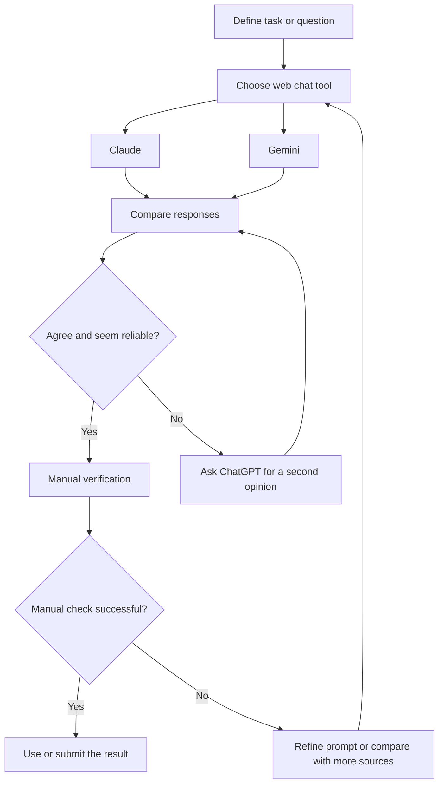

# Personal LLM Workflow

My usual workflow is based on web chat interfaces rather than a coding assistant or subagents. I most often use Claude and Gemini, which is available to students for free, and compare their answers. If their responses differ or need additional checking, I use ChatGPT to verify whether the results are correct.

I validate responses mainly by cross-checking multiple models and also by reviewing the answer manually. The final decision is mine; I do not rely on a single generated response.

